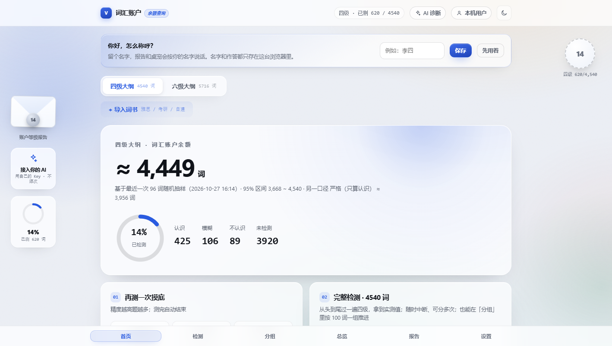
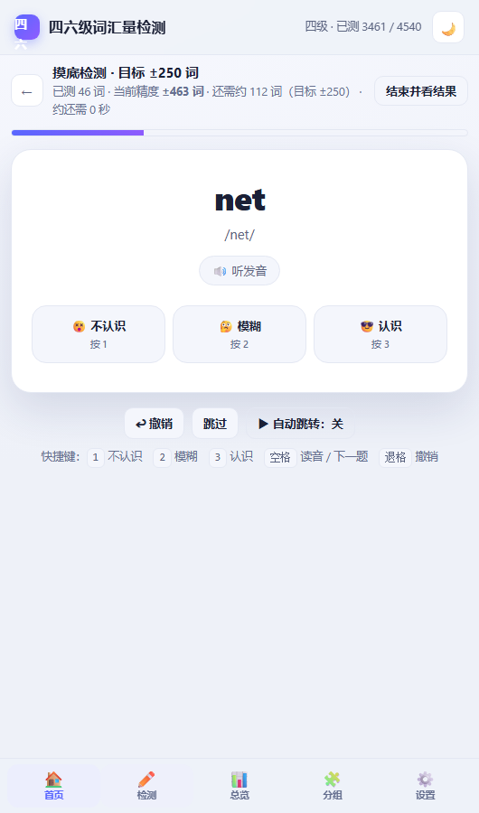
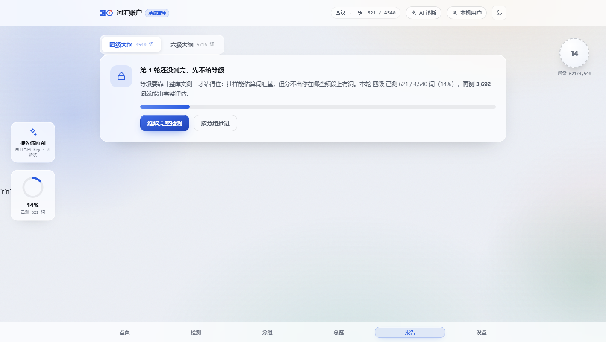

# 四六级词汇量检测 · CET Vocabulary Checker

> 用词频分层抽样把「词汇量」测准，再把测出来的结论变成可执行的复习计划。

**在线演示**：（部署后填写） · **离线版**：直接双击 `index.html`，无需联网、无需安装

> [!IMPORTANT]
> **接手的开发者 / AI 会话请先读两份文件：**
> - **[NEXT.md](NEXT.md)** —— 当前进度、下一步、以及**四条已失败、不要再试的路线**
> - **[LICENSING.md](LICENSING.md)** —— 形象素材的授权核对，哪些图能用、哪些不能
>
> 改完代码跑一遍 `npm test`（100 项）和 `npm run test:browser`（26 项），
> 全绿才算没改坏。

---

## 这是什么

一个面向四六级考生的**词汇量检测工具**。它不做背单词、不做打卡，只专注一件事：**把数字测准**。

市面上绝大多数「词汇量测试」给你一个数字就完事，不告诉你这个数字有多大误差、怎么来的。
本项目把测量过程完全摊开：抽样方法、置信区间、口径定义全部写在界面上。

### 两套词库

| 词库 | 规模 | 说明 |
| --- | --- | --- |
| 四级大纲 | 4540 词 | 大学英语四级大纲词汇表全量 |
| 六级大纲 | 5716 词 | 六级大纲全量，含四级全部 + 六级新增 1176 词 |

全部词条带国际音标，3760 条带常用短语；两套词库共用一份作答记录，四级测过的词切到六级无需重测。

## 核心能力

### 1. 分层抽样（按词频）

在 4540 个词里简单随机抽题，误差主要来自「这一把抽到多少冷门词」。本项目先按**词频段**
（最高频 1k / 1k-2k / … / 10k-20k）分层，再等比例交错抽题：

- 同样题量下**置信区间更窄**（频段间掌握率差异越大，收益越明显）；
- 任何一个前缀仍是合法的分层样本，因此可以**边测边看精度、随时喊停**。

### 2. 目标精度自适应停测

用户直接选「误差 ±400 / ±250 / ±150 词」，系统抽到目标精度就自动结束，不做固定题量。
答题过程中实时显示：`已测 46 词 · 当前精度 ±463 词 · 还需约 112 词（目标 ±250）`。

### 3. 频段剖面报告

输出不是单个数字，而是「哪个频段强、哪个频段弱」的剖面，例如：

> 最高频 1k **98%** ｜ 1k-2k 93% ｜ 2k-3k 83% ｜ 3k-5k 83% ｜ 5k-10k 77% ｜ 10k-20k **72%**

并据此指出提分空间所在，给出「只复测这一段」的可执行按钮。

### 4. 统计口径的较真（这是本项目最不一样的地方）

- **两种口径同时给出**：严格（只算「认识」）与折中（「模糊」按一半折算）——模糊词算不算掌握没有标准答案，两个数都列出来；
- **Agresti-Coull 区间修正**：避免「20 题全对 → 误差 ±0 词 → 报告 4540 词」这种数学笑话；
- **有限总体修正**：不放回抽样，覆盖率越高区间收得越紧；
- **四选一蒙对校正**：正确率按 (p − 1/k)/(1 − 1/k) 折算回真实掌握率；
- **非随机样本不外推**：分组检测虽然顺序已打乱，但「测哪几组」是用户自己挑的（有选择偏差），不参与词汇量估算；抽样按词库隔离。

### 5. 词汇等级评估报告（整库测完之后）

抽样能给词汇量和误差，但给不了「你在哪些频段上有洞」。所以当整个词库覆盖到 95% 以上时，
报告改用**全库实测**（不再估计），输出一份可执行的等级评估：

- **等级判定**：S 卓越 / A 优秀 / B+ 良好 / B 中等 / C 偏弱 / D 基础薄弱。
  等级按**当前词库的掌握率**换算，所以四级（4540 词）和六级（5716 词）的同一等级对应不同词数；
- **地基约束**：只看总比例会得出荒谬结论——把最高频 1k 段整段丢掉，总掌握率还有 85%，
  按比例照样能评「优秀」，可这样的词汇结构读任何一段真实文本都会卡。
  所以最高频段掌握率低于 85% / 75% / 60% 时，等级分别封顶在 A / B+ / C，并在报告里说明原因；
- **掌握深度**：认识 / 模糊 / 不认识分开算，指出「模糊」占比过高时词汇量有虚高成分；
- **提升路径**：按 **缺口词数 × 词频权重** 排序（不是按缺口绝对值）。
  10k-20k 段可能缺得最多，但那些词一年也遇不上几次；最高频段缺几个词，却是每次阅读都会撞上的；
- 逐频段列出实测掌握率与缺口词数，可一键复测该段、导出缺口词表（CSV）、复制报告文本。

入口有两个：左侧悬浮的**信封**（未测完时蜡封显示覆盖率，测完后显示等级字母），
以及底部导航的「报告」页。

### 6. 多轮检测与逐词对比

整库测完后首页会出现「重新测试 · 开始第 N 轮」。开始新一轮会清空本轮作答，
但**每一轮的等级报告都会归档**（`历轮报告`），可以一直测下去。

多轮真正的价值不是「再测一次」，而是**逐词对比**——单轮永远算不出这些：

| 指标 | 含义 |
| --- | --- |
| 保持率 | 上轮认识的词，这轮还记得的比例 |
| 新学会 | 上轮不会 / 模糊 → 这轮认识 |
| **背了又忘** | 上轮认识 → 这轮模糊或不认识 ← 复习的第一优先级，可一键复测这批词 |

每轮归档一份 2 bit/词的逐词状态位图（7175 词约 1.8 KB）与词表指纹；
词表版本变化时自动退化成只比总体数字，换了词库（四级↔六级）时也只会给出可比的逐词结论。

### 7. 词汇地图

把 7175 词画成一张「地形图」：**纵轴词频段（越靠上越常用）× 横轴首字母**，每格是该交叉点的掌握率。
**颜色 = 掌握率，浓淡 = 这一格测过多少**——所以「一片虚线格」就是整块没测过，「一片深红」就是都测过且都不会。
点任意一格直接复测那一块的缺口词。

图表刻意区分「缺口（测过还不会）」与「没测过（不构成结论）」，不把两者混成一句话。

### 8. 视觉与质感（零依赖）

界面质感统一在一条主线上：**让光和纸动起来**。六项视效全部纯 CSS/JS 实现，不引入任何动画引擎：

- **极光缓动**：两团超大径向柔光缓慢反向漂移，只动 `transform`；
- **纸颗粒**：feTurbulence 噪点层，浅色 multiply / 暗色 screen，去掉纯渐变的塑料感；
- **卡片聚光**：光斑跟随指针（Spotlight Card），一次委托 + `rAF`，只写两个 CSS 变量；
- **标题流光**：首屏标题用 `background-clip:text`，9.5 秒周期里扫过一小段高光；
- **导航滑块**：选中态是一块会滑动的指示片；
- **按钮流光 + 磁吸**：主 CTA 周期性扫光，并朝指针方向偏移最多 4px。

约束：只动 `transform` / `opacity` / CSS 变量；触摸设备与 `prefers-reduced-motion` 自动降级；
视效层失效不影响主流程。**「0 运行时外部依赖」这条架构承诺没有被破坏。**

### 9. 入场页：每次打开都是一次「登场」

打开文件先看到一页入场：细线展台框从左画出、标题逐字从遮罩里升起、词库规模数字滚动到位、
鲸鱼娘入场后<b>绕视口跑一圈</b>（带拖影与颠簸），最后压成一道光束扎进「进入」按钮、命中时按钮起涟漪——点「进入」（或按 Enter / 点空白处）后整屏做一次「镜头对焦」式退场，
主界面卡片错峰升起，桌宠此刻才登场。**每次打开都会出现**，不记忆「已看过」。

实现上没有引入任何库，全部是 `transform / opacity / filter`（在合成层上跑，不触发布局）：

| 细节 | 为什么这么做 |
| --- | --- |
| 内容其实早已渲染好，入场页只是盖在上面 | 退场是纯视觉过渡，不会出现「点了进入还要等」的空窗 |
| 入场期间给主界面加 `inert` | 键盘 Tab 走不进看不见的界面里，读屏也不会念到隐藏内容 |
| `?intro=0` | 自动化测试与录屏调试用，不影响正常打开 |
| `prefers-reduced-motion` | 关掉全部动画但**仍然要点击进入**：尊重设置，但不替用户做决定 |
| 焦点管理 | 打开即聚焦「进入」（回车就能进）；进入后焦点交还主内容区 |

### 10. 可离线、可分享、隐私优先

- 打包成**单文件 HTML**（约 2.0 MB，词库内嵌），双击即用，断网可用；
- 所有作答默认只存浏览器 localStorage，不上传；
- **按使用者分开存放**：同一台电脑上换人用，新建一个使用者即可，互不可见；把文件发给别人，对方打开是干净的空档案（数据不跟着文件走）；
- 一键复制成绩文本、打印/另存为 PDF（专门的打印样式，只保留报告本体）。

#### 把文件发给别人，对方能正常用吗

**能。** 这条不是口头承诺，是 `scripts/check-recipient.mjs` 验过的：它把 HTML 拷进一个**空目录**
（没有 `assets/`、没有 `data/`、没有 `server/`）、用**全新浏览器配置**（没有 localStorage 与缓存）、
**屏蔽全部 http/https**（等价于断网），再分别用桌面 1440×900 和手机 390×844 跑完整流程。

| 场景 | 结果 |
| --- | --- |
| 打开即用（词库 / 例句 / 桌宠立绘全部内嵌） | ✅ 7175 词，无外部资源请求 |
| 作答、记忆进度（file:// 下 localStorage 可用） | ✅ 刷新、重开都在 |
| 手机 / 平板浏览 | ✅ 无横向溢出，主按钮在屏内，桌宠自动收起 |
| 同一台电脑换人用 | ✅ 使用者档案互不可见 |
| AI 诊断（对方没有本地后端） | ✅ 自动降级为**离线规则诊断**：用本机数据算出频段短板、最该补的一段、具体该背哪些词、下一轮怎么测，并支持追问 |

需要注意的限制，**如实写在这里**：

- **进度只存在对方自己的浏览器里**：清除浏览器数据会丢，设置页可以「导出作答备份（JSON）」，之后「导入备份」恢复；
- **不跨设备同步**：没有账号系统，换电脑/换浏览器就是新档案；
- **微信 / QQ 内置浏览器**可能不保留 localStorage、也不方便另存，建议选「用浏览器打开」再使用；
- **AI 诊断的完整形态需要本地后端**（`node server/index.mjs`）。离线时给的是规则诊断，不是大模型；
  两条路径都验证过：`scripts/check-recipient.mjs`（离线）与 `scripts/check-online-ai.mjs`（联网）。
- **发音**依赖系统语音引擎：Windows/macOS 自带，部分精简版系统可能没有声音，不影响答题。

## 界面预览

| 第一次打开 | 摸底检测进行中 | 检测报告 |
| --- | --- | --- |
|  |  |  |

## AI 诊断教练（开发中）

检测完成后，可以点「AI 诊断教练」，用自然语言问「我该怎么补」。它的设计原则是**不让大模型做算术**：

- **AI 与图表双向联动**：图表上可按频段/格子带着真实数字去问 AI；模型也能返回结构化动作
  （跳页、开一轮摸底、复测某一段），前端渲染成按钮、点击即执行——动作参数经前后端双向白名单校验；
- **入口常驻可见**：顶栏「AI 诊断」按钮随时可打开，设置页有「AI 诊断与授权」区块显示当前形态
  （离线规则 / 已授权大模型）；
- 所有数字由工具层提供（`get_profile` / `get_band_profile` / `get_weak_words` / `plan_schedule` / `suggest_actions`），
  模型只负责解释与规划；
- 界面上会显示「✓ 读取整体情况」「✓ 读取频段数据」等标签，把工具调用过程可视化，结论可核对；
- 只上传**汇总数据**（覆盖率、频段掌握率、未掌握词清单），逐题作答记录不出本机；
- **降级设计**：未配置 API Key 或模型服务不可用时切本地规则诊断；**后端整个不在**（单文件发给别人时的常态）
  也照样给结论——面板会如实标成「离线 · 本地规则」，并用本机数据算出频段短板、最该补的一段、
  该背哪些词与下一轮怎么测，不再出现"请先启动后端"这种给开发者看的死胡同。

```bash
cp .env.example .env    # 填入 API Key（.env 不会进入仓库）
npm run server          # 启动后端，默认 http://127.0.0.1:8787
```

支持的模型：DeepSeek / 通义千问 / 智谱（OpenAI 兼容协议）与本地 Ollama，改 `.env` 里 `LLM_PROVIDER` 一行即可切换。

### AI 的两级形态：谁都能用的离线诊断 + 后端在则有真模型

> **当前交付的产物不含任何 API Key**（公开仓库纪律，见 `scripts/check-no-key.mjs`）。
> AI 有**三档通路**，面板右上角永远显示你现在用的是哪一档：
>
> | 档 | 触发条件 | 次数 | 谁付费 |
> | --- | --- | --- | --- |
> | **自带 Key** | 在「设置 → AI 与额度」填入自己的 Key | 不限次 | 你自己 |
> | **作者额度** | 完成一次有效检测（整库 ≥100 词且覆盖 ≥95%，或达标摸底 ≥80 题）换 1 次 | 用的就是换来的次数 | 作者 |
> | **本地方案** | 上面都不满足时 | 不限次 | 不花钱 |
>
> 带作者额度的「评委演示版」由作者本地用 `node build.js --with-key` 构建后单独提交，**不进仓库**。

### AI 的两级形态：谁都能用的离线诊断 + 需要授权的真模型

单文件发给别人时，AI 面板分两级，**面板上的标签会如实告诉用户现在是哪一级**：

| 形态 | 触发条件 | 花钱吗 | 能力 |
| --- | --- | --- | --- |
| **离线规则诊断** | 默认，任何人打开就有 | 不花钱 | 用本机数据算出：依据块（覆盖率、两个口径的掌握率、估计值 ± 区间、最弱两段）、按问题类型给侧重、可追问 |
| **大模型诊断** | 输入作者给的**访问密码** | 消耗作者额度 | 模型解释与规划，回答更灵活（同样只拿到汇总数据） |

**原理**：作者跑一次 `node scripts/make-ai-lock.mjs "自己定的密码"`，脚本把 API Key 用
**PBKDF2-SHA256（60 万次迭代）派生的密钥 + AES-GCM** 加密，密文内联进产物。
HTML 里**没有明文 Key**（`scripts/check-ai-lock.mjs` 会把 `.env` 里的 Key 拿去逐字节比对，断言搜不到）。
对方输入正确密码 → 浏览器用 WebCrypto 派生同一把密钥解出 Key → 直接调模型厂商（DeepSeek 允许跨域，
`file://` 也能调）；**解出的 Key 只存在内存里，刷新页面即失效**，授权就是「这一次打开」。

```bash
node scripts/make-ai-lock.mjs "你的密码"     # 生成密文并重建 index.html
node scripts/make-ai-lock.mjs --off          # 撤销授权（产物变回纯离线版）
```

**安全边界，必须说清楚**：密文是公开的（谁拿到 HTML 都能离线跑字典，没有速率限制），
所以**密码强度就是唯一防线**。脚本会拒绝短密码并给出爆破耗时估算——
6 位纯数字在单张显卡上约 55 秒，18 位的长口令约 1.3 万年。
Key 万一泄露，去厂商后台轮换后重跑一次脚本即可。`private/ai-lock.json` 已在 `.gitignore` 里，不会进仓库。

## 技术架构

```
┌─────────────────────────────────────────────┐
│  前端（原生 JS，零运行时依赖）               │
│  ├─ 词库层   7175 词条 · 词库掩码 · 词频段   │
│  ├─ 抽样引擎 分层抽样 · 自适应停测 · 区间估计 │
│  ├─ 答题界面 自评 / 四选一 · 键盘流 · 无障碍   │
│  └─ 报告层   频段剖面 · 首字母分布 · 记录     │
└─────────────────────────────────────────────┘
        ↓ 构建期
   build-data.js   第三方词表 → 解析/合并/去重/音标/词频分段 → words.json
   build.js        src/* + words.json → 单文件 index.html
```

设计取舍：

- **零运行时依赖**：不引框架，保证离线可用与首屏速度（实测 DOMContentLoaded 约 45 ms）；
- **构建期解决数据问题**：所有清洗逻辑放在 `build-data.js`，产物是纯数据，运行时不背历史包袱；
- **测试先行**：抽样与区间估计这类「看不见的正确性」全部有自动化断言。

## 快速开始

```bash
# 1. 安装开发依赖（只用于测试）
npm install

# 2. 拉取第三方词表并构建 words.json
npm run data

# 3. 打包单文件产物 index.html
npm run build

# 4. 跑测试
npm test           # 164 项功能测试（jsdom）
npm run audit      # 22 项历史缺陷复检
```

只想用的话：双击 `index.html` 即可，不需要任何环境。

## 目录结构

```
index.html          单文件产物（可直接双击使用）
words.json          处理后的词库（7175 条）
build-data.js       词库构建：解析 → 合并 → 去重 → 音标 → 词频分段
build.js            打包：src + words.json → index.html
src/
  index.template.html  页面骨架
  app.css              样式（含深色模式与打印样式）
  app.part1.js         词库/抽样引擎/首页/分组
  app.part2.js         答题引擎与答题界面
  app.part3.js         报告/总览/设置/事件
scripts/
  fetch-data.mjs       按固定 SHA 拉取第三方词表
smoke-test.js       164 项功能测试
btest.js            真实浏览器验证（44 项）· 生成 shots/btest.html 后用 scripts/cdp-eval.mjs 执行
audit-*.js          数据与行为审计脚本
shots.js            截图页面生成器
data/               第三方原始数据（不提交，见 data/README.md）
```

## 质量数据

| 项目 | 结果 |
| --- | --- |
| 功能测试（jsdom） | 164 / 164 通过 |
| 真实浏览器验证（Chrome） | 54 / 54 通过 |
| 桌宠行为（真实浏览器） | 30 / 30 通过 |
| 入场页验收（真实浏览器） | 43 / 43 通过 |
| 离线交付检查（孤立单文件） | 7 / 7 通过 |
| 收件人环境（空目录 + 断网 + 双视口） | 18 / 18 通过 |
| AI 授权链路（密码锁） | 14 / 14 通过 |
| 自定义词书（导入 / 预览 / 切换 / 删除） | 18 / 18 通过 |
| AI ↔ 可视化双向联动（含动作白名单） | 9 / 9 通过 |
| 联网 AI 主路径（需后端） | 7 / 7 通过 |
| **合计** | **364 条断言** |
| 首屏渲染 | 约 120 ms（DOMContentLoaded） |
| 产物体积 | 约 2.06 MB（含内嵌词库、例句与 10 张表情立绘） |

## 数据来源与授权

词库来自多个公开词表，**原始数据不随仓库分发**，用 `npm run data` 按固定 commit 拉取。
各来源的授权与合规说明见 **[data/README.md](data/README.md)**。

请注意：`mahavivo/english-wordlists` 未声明 license，本项目以「按需拉取、标注来源」的方式使用；
若用于商业用途请先取得原作者授权。本项目代码以 MIT 发布，该许可不覆盖第三方数据。

## 界面形象与第三方素材

右下角有一只**桌宠**：可以拖着走、松手会自由落体、闲着自己溜达、点一下会跳、双击回原位，
**抓起来会悬空挣扎**（换成不高兴的立绘、喊一句"放我下来"、被拖着走时身体落在手后面还带余摆）。
形象是一套 512×512 透明底的**全身立绘**，靠三层叠加做出 2.5D 的立体感：

| 层 | 做法 |
| --- | --- |
| 透视倾斜 | 鼠标位置 → `rotateX/rotateY`，转轴压在脚底，倾斜时脚不动、只有上身摆 |
| 接地投影 | 上下两层椭圆，跟着倾斜反向横移，跟着离地高度缩小变淡；被拎起来时留在原地不跟着脚飞 |
| 受光膜 | 一条跟着倾斜转的斜向反光，暗示光源在左上 |
| 悬空弹簧 | 被抓起后换一层 `transform-origin` 到耳根，摆动角/落后量/拉伸挤压由指针速度驱动的二阶系统逐帧积分 |

情绪会换立绘（待机 / 打招呼 / 思考 / 庆祝 / 疑惑 / 难过 / 生气 …），切换时交叉淡入。
走碎步时整体镜像，落地有挤压回弹。**单文件离线版内联全部 10 张情绪立绘**
（384×384 WebP，合计约 349 KB，见 `scripts/make-pet-art-inline.mjs`），因此断网时表情照常工作；
一张都拿不到时桌宠只保留气泡，不留空洞。
窄屏（&lt;820px）不显示桌宠，避免遮挡内容。

**立绘是第三方作品**，授权 **MIT**（可商用、可改编），作者 **Sutera-Diffusus**
（经 `1TRYOUT/dsh-whale-pixel-pet` 分发）。署名保留在应用内「**设置 → 素材来源**」，
完整说明见 **[assets/whale-art/ATTRIBUTION.md](assets/whale-art/ATTRIBUTION.md)**。
素材可用 `npm run art:fetch` 重新拉取。

> 早先版本用的是 `assets/whale-girl/` 里的 Live2D 模型（CC BY-NC-SA），
> 因为该模型只画了下半身以上的"桌前胸像"、做不出"站在地上"的全身效果，已停用；
> 素材仍留在仓库里备查，但页面不再加载，也不再进入单文件产物。

## 团队信息

| 角色 | 姓名 | 负责内容 |
| --- | --- | --- |
| 队长 / 前端 | （待填） | 检测引擎、界面与交互 |
| （待填） | （待填） | （待填） |

学校：广东亚视演艺职业学院 · 信息工程学院

## 路线图

- [x] 词频分层抽样引擎与自适应停测
- [x] 频段剖面诊断报告
- [x] 词汇等级评估报告（整库实测 + 地基约束 + 缺口加权排序）
- [x] 多轮检测与逐词对比（保持率 / 新学会 / 背了又忘）
- [x] 词汇地图（词频段 × 首字母的掌握地形图，点击即复测）
- [x] 使用者档案（同一台电脑上多人使用，数据互不可见）
- [x] 离线单文件产物与完整测试体系
- [ ] AI 诊断 Agent：把统计结论翻译成可执行的学习计划（工具调用，模型不参与计算）
- [ ] 例句检索增强（RAG）：为词条配真实语境例句并标注来源
- [ ] 智能出题：基于词库生成语境填空，测量「主动词汇」而非仅「被动词汇」

## 许可

本项目代码采用 MIT 许可，第三方数据授权情况见 [data/README.md](data/README.md)。