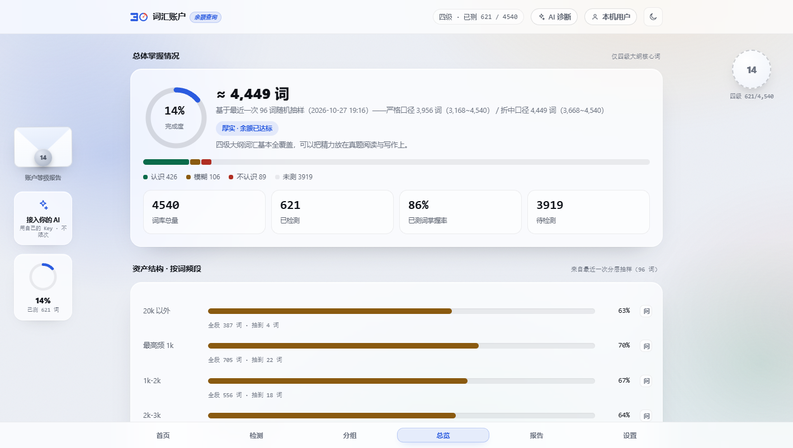
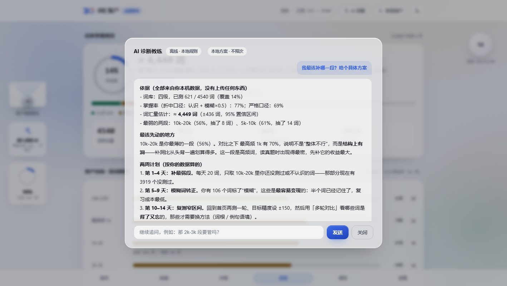
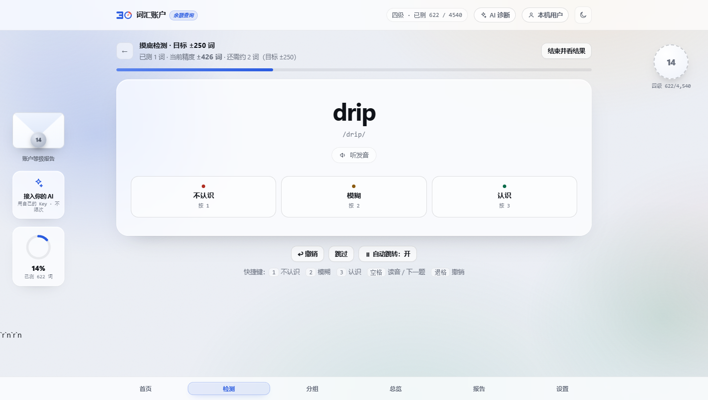

# 词汇账户余额查询

> **四六级词汇量检测与诊断** · CET-4 / CET-6 Vocabulary Profiler
>
> 名字的来历：像查账户余额一样查你的词汇——**余额**是当前词汇量，**资产结构**是词频段分布，
> **充值**是补词单，**到账**是复测验证，**坏账**是背了又忘的词。

> 用词频分层抽样把「词汇量」测准，再把测出来的结论变成可执行的补词计划。
> **不背单词、不打卡、不要账号、不联网也能用。**

**离线版**：双击 `index.html` 即可，无需安装、无需联网 ·
**单文件产物** 约 2.08 MB · **自动化断言** 387 条 · **运行时依赖** 0

> [!IMPORTANT]
> **接手的开发者 / AI 会话请先读两份文件：**
> - **[NEXT.md](NEXT.md)** —— 当前进度、逐条设计决策、踩过的坑、以及**已失败不要再试的路线**
> - **[LICENSING.md](LICENSING.md)** —— 形象素材的授权核对，哪些图能用、哪些不能
>
> 改完代码必须跑通下面四套（全绿才算没改坏）：
> ```bash
> npm test                                              # 164 项功能测试（jsdom）
> npm run test:pet                                      # 40 项桌宠行为（真实 Chrome）
> node scripts/check-intro.mjs                          # 43 项入场页
> node scripts/check-offline.mjs "./index.html"          # 7 项孤立单文件
> ```
> 提交前另外必跑 `node scripts/check-no-key.mjs`（见「两种产物」一节）。

---

## 这是什么

一个面向四六级考生的**词汇量检测工具**。它不做背单词、不做打卡，只专注一件事：**把数字测准，并说清差在哪**。

市面上绝大多数「词汇量测试」给你一个数字就完事，不告诉你这个数字有多大误差、怎么来的。
本项目把测量过程完全摊开：抽样方法、置信区间、口径定义全部写在界面上。

一句话概括产品边界：**我们生产处方，不生产药。**
规划环节输出的是可带走的词单与验收线，用户拿着它去用惯的任何产品背——本项目不抢那个场景。

### 词库

| 词库 | 规模 | 说明 |
| --- | --- | --- |
| 四级大纲 | 4,540 词 | 四级大纲全量 |
| 六级大纲 | 5,716 词 | 含四级全部 + 六级新增 1,176 词 |
| 含拓展派生词 | 4,969 / 7,175 | 开关控制，默认不计入 |
| **自定义词书** | 任意外部词表 | 导入后按同一套引擎检测（见下） |

全部词条带国际音标、5,104 条带常用短语；四级测过的词切到六级无需重测。

## 核心能力

### 1. 分层抽样（按词频）

在 4,540 个词里简单随机抽题，误差主要来自「这一把抽到多少冷门词」。本项目先按**词频段**
（最高频 1k / 1k–2k / 2k–3k / 3k–5k / 5k–10k / 10k–20k / 20k 以外）分层，再等比例交错抽题：

- 同样题量下**置信区间更窄**（频段间掌握率差异越大，收益越明显）；
- 极端情况也不会失控：抽到「全是冷门词」的概率被结构性地压掉了。

检测顺序由**单词自身哈希**决定（FNV-1a），不是 `Math.random()`：看起来随机，但每次打开、
每台机器完全一致——否则「第 N 组」会指向另一批词，进度与跨轮对比全部失真。

### 2. 目标精度自适应停测

不预设题量。你要 ±250 词，它边测边算区间宽度，达到就提示「精度达标，可以收工」，
没达到就告诉你「再答约 N 题」。页面上实时显示当前精度。

### 3. 区间估计的三层修正 + 两套口径

这是本项目最「较真」的地方：

| 修正 | 解决什么 |
| --- | --- |
| Agresti-Coull | 小样本下比例区间不稳（Wald 在 p→0/1 时崩），加伪计数后再算 |
| 有限总体修正 | 不放回抽样，总体只有几千词，覆盖率越高越该收窄（乘 `√(1−n/N)`） |
| 蒙对校正 | 四选一即使不会也有 1/k 概率答对，掌握率扣掉猜测基线 |

并且同时给出**严格口径**（只算「认识」）与**折中口径**（「模糊」按一半计入）——
不用一个数字糊过去。

### 4. 频段剖面诊断

总掌握率会把高低频段平均掉。所以诊断落到 **7 个词频段**，每段给出掌握率、缺口词数、未测词数，
并按「**缺口词数 × 词频权重**」排出提升优先级——避免把最冷门的词排在最前。

「缺口」（测过还不会，真正的洞）与「未测」（压根不知道，不构成结论）**刻意分开**。

### 5. 词汇等级评估（整库测完之后）

覆盖率 ≥95% 自动切实测口径，给出 S/A/B+/B/C/D 六档（S≥92% / A≥85% / B+≥75% / B≥65% / C≥50%）。

带**地基约束**：最高频段掌握率过低时封顶，防止「高频段空洞却因总比例漂亮而评优」——
那样的词汇结构读任何真实文本都会卡。

### 6. 多轮检测与逐词对比

每轮归档报告快照 + **逐词 2 bit 位图** + 词表指纹。跨轮把词分成四类：
**背了又忘**（上轮认识、这轮模糊或不认识）、新学会、掉档、稳会。
只有「背了又忘」那类才需要换方法，其余继续推进即可。

### 7. 词汇地图（182 格）

7 个词频段 × 26 个首字母的掌握地形图。颜色=掌握率，浓淡=这一格测过多少，**点格子直接复测该格的缺口词**——
地图不只是图，是入口。`Shift + 点击` 可带着这一格的真实数字去问 AI。

### 8. 自定义词书（导入外部词表）

支持 `.txt / .csv / 直接粘贴`（一行一词，可选「词,释义」），自动去重、跳过表头与注释。
导入前**强制预览**：多少词命中内置词库、多少是新增、频段分布如何。

- 命中内置词库 → 复用原释义/音标/频段；
- 不在其中 → 补进词表，频段记为「20k 以外」（不在前 20k 词频表，是事实不是猜测）；
- 抽样、区间估计、词汇地图、跨轮差分**一行未改**，全部复用。

> 自定义词书只报「**对这本书的掌握率**」，并在界面上常驻提示**不能换算成词汇量**——
> 词书是人挑出来的有偏样本，外推不成立。这条边界不让步。

### 9. AI 诊断：三档通路 + 与图表双向联动

面板右上角永远显示你现在用的是哪一档：

| 档 | 触发条件 | 次数 | 谁付费 |
| --- | --- | --- | --- |
| **自带 Key** | 设置里填入自己的 API Key（DeepSeek 等允许浏览器跨域的厂商） | 不限次 | 你自己 |
| **作者额度** | 完成一次有效检测换 1 次（整库需测过 ≥100 词且覆盖 ≥95%，或达标摸底 ≥80 题） | 换来的次数 | 作者 |
| **本地方案** | 上面都不满足时 | 不限次 | 不花钱 |

**后端 Agent**：8 个工具（整体情况 / 频段明细 / 未掌握词 / 复习计划 / 词库列表 / 例句检索 /
批量例句 / 给出可执行动作），最多 3 轮工具循环，过程在界面上显示成 `✓ 读取频段数据` 这样的标签。

设计上守三条规矩：

1. **模型不做算术**：所有数字来自工具返回值，Prompt 明确禁止自行估算；数据不足时必须说「样本太少，不能下结论」。
2. **单一数据源**：后端工具**不重算**统计，直接消费前端算好并已显示在界面上的数——
   所以「AI 说的数」与「页面上的数」结构上不可能漂。
3. **只上行汇总**：覆盖率、频段掌握率、未掌握词清单；**逐题作答永不出本机**，且回答下方可展开「本次发送给模型的数据」核对。

**双向联动**：频段条每段的「问」、地图 `Shift+点击`、「让 AI 解读这张地图」会把该段/该格的真实数字带进提问；
反过来，模型的结论能返回**结构化动作**（跳页面 / 开一轮摸底 / 复测某段 / 追问），前端渲染成按钮，
点击即执行（参数经前后端两次白名单校验）。

### 10. 入场页：每次打开都是一次「登场」

细线展台框自左画出 → 标题逐字从遮罩升起 → 词库规模数字滚动 → 小鲸鱼绕视口跑一圈、
压成一道光束扎进「进入」按钮 → 整屏「镜头对焦」式退场 → 主界面卡片错峰升起。

内容其实早已渲染完成，入场页只是盖在上面的一层，所以退场是纯视觉过渡、**没有加载空窗**。
`?intro=0` 可跳过；`prefers-reduced-motion` 下关掉动画但仍要点击进入。

### 11. 视觉与 2.5D 桌宠

右下角一只小鲸鱼：会呼吸、会自己溜达（只在右侧安全区，不横穿正文）、会跟着鼠标看、可拖动、松手有重力、
双击回原位；**抓起来会悬空挣扎**——转轴从脚底挪到耳根，摆动角/落后量/拉伸挤压由指针速度驱动的二阶系统逐帧积分，
换不高兴的表情并喊一句，落地抖灰。

| 层 | 做法 |
| --- | --- |
| 透视倾斜 | 鼠标位置 → `rotateX/rotateY`，转轴压在脚底，倾斜时脚不动 |
| 接地投影 | 两层椭圆，跟倾斜反向横移、随离地缩小变淡；被拎起时留在地面 |
| 受光膜 | 一条跟着倾斜转的斜向反光，暗示光源在左上 |

零依赖：全部纯 CSS/JS，只动 `transform / opacity / filter`，不掉帧。

### 12. 可离线、可分享、隐私优先、可带走

- **单文件 HTML（约 2.08 MB）**，词库、例句、立绘全部内联；双击即用，断网可用；
- 作答只存浏览器 localStorage，**不上传**；按使用者档案隔离，同机换人互不可见；
- **一键带走**：导出作答备份 JSON / 未掌握词表 CSV / 报告文本 / 打印为 PDF；
- 逐词状态用 2 bit 压缩（7,175 词 ≈ 1.8 KB/轮），localStorage 5 MB 可存约 2,900 轮。

## 界面预览

| 首页 | 答题 | 报告 |
| --- | --- | --- |
|  |  |  |

| 词汇地图与频段剖面 | AI 诊断（工具调用可视化） | 例句与释义 |
| --- | --- | --- |
|  |  |  |

## 技术架构

```
                    ┌─────────────────────────────────────────┐
                    │  单文件 index.html（约 2.08 MB）          │
   词库 7,175 词 ────▶│  ├─ 抽样与估计引擎（浏览器内完成）        │
   例句 9,204 条 ───▶│  ├─ 答题引擎 / 报告 / 词汇地图            │
   立绘 10 张 ──────▶│  ├─ 2.5D 桌宠 + 入场页 + 视效层           │
                    │  └─ AI 面板（三档通路）                   │
                    └───────────────┬─────────────────────────┘
                                    │ 只上行「汇总数据」(可选)
                                    ▼
                    ┌─────────────────────────────────────────┐
                    │  server/（Node 原生 http，零框架）         │
                    │  ├─ Agent 循环：模型只解释，不做算术       │
                    │  ├─ 8 个工具：数字全部来自工具返回值       │
                    │  └─ 本地语料检索（Tatoeba 9,204 条）       │
                    └─────────────────────────────────────────┘
```

设计取舍：

- **零运行时依赖**：不引框架，保证离线可用与首屏速度（实测 DOMContentLoaded 约 120 ms）；
- **构建期解决数据问题**：清洗与索引都在构建期做，运行时不背历史包袱；
- **单一数据源**：统计只算一次（在前端），后端工具直接消费，避免两套数字漂移；
- **测试先行**：抽样与区间估计这类「看不见的正确性」全部有自动化断言，共 387 条。

## 快速开始

**只是用**：双击 `index.html`。

**要开发 / 重建**：

```bash
npm install            # 只装测试用依赖
npm run data           # 按固定 SHA 拉取第三方词表 → words.json
npm run build          # 打包单文件产物 index.html

npm test               # 164 项功能测试（jsdom）
npm run test:pet       # 40 项桌宠行为（真实 Chrome）
npm run test:browser   # 生成真实浏览器断言页（用 scripts/cdp-eval.mjs 执行）
```

**两种产物（重要）**：

```bash
node build.js                  # 仓库版：不含任何 API Key，可安全提交
node scripts/check-no-key.mjs  # 提交前必跑：扫明文 sk-、与真实 Key 逐字比对，发现即失败
node build.js --with-key       # 评委版：内联作者 Key（private/ai-key.json，已 gitignore）
```

**可选后端**（需要 AI 工具调用时才用）：

```bash
cp .env.example .env    # 填入 API Key（.env 不会进入仓库）
npm run server          # http://127.0.0.1:8787
```

支持 DeepSeek / 通义千问 / 智谱（OpenAI 兼容协议）与本地 Ollama，改 `.env` 里 `LLM_PROVIDER` 一行即可切换。
浏览器直连要注意 CORS：实测 **DeepSeek 允许**、OpenAI / 智谱默认拒绝——所以「自带 Key」那档推荐 DeepSeek。

## 目录结构

```
index.html            单文件产物（可直接双击使用）
words.json            处理后的词库（7,175 条）
sentences.json        例句库（9,204 条 / 覆盖 5,138 词）
build.js              打包：src + 数据 + 立绘 → index.html
build-data.js         词库构建：解析 → 合并 → 去重 → 音标 → 词频分段
build-corpus.js       例句库构建：Tatoeba 英中对照 → 过滤 → 倒排索引 → 可读性打分
src/
  index.template.html 页面骨架
  app.css             样式（设计令牌 / 深色模式 / 打印样式 / 全部动效）
  app.part1.js        状态·档案·词库·抽样与估计·等级·地图·路由
  app.part2.js        答题引擎（队列、判分、计时、发音）
  app.part3.js        结果页·总览·设置·事件分发
  app.part4.js        AI 面板（工具链可视化、三档通路、动作白名单）
  app.part5.js        桌宠（2.5D、行为、悬空物理、自愈守卫）
  app.part6.js        等级报告页与多轮对比
  app.part7.js        入场页 + 视效层
  app.part8.js        自定义词书（解析 / 预览 / 保存 / 管理）
server/
  index.mjs           Node 原生 http：/api/health、/api/examples、/api/agent（SSE）
  agent.mjs           Agent 循环（最多 3 轮工具调用）
  tools.mjs           8 个工具 + 白名单归一化
  corpus.mjs          本地语料检索
  llm/                模型适配器（openai-compat / ollama）
scripts/
  pet-test.mjs        40 项桌宠行为（DevTools 协议）
  check-intro.mjs     43 项入场页
  check-offline.mjs   7 项孤立单文件
  check-recipient.mjs 18 项「别人收到文件」的环境
  check-book.mjs      17 项自定义词书
  check-ai-tiers.mjs  17 项三档通路与额度
  check-ai-link.mjs   14 项 AI↔可视化双向联动
  check-ai-lock.mjs   6 项授权锁（可选功能回归）
  check-online-ai.mjs 7 项联网主路径（需后端）
  check-no-key.mjs    提交前 Key 泄漏守卫
  make-ai-lock.mjs    可选：用密码加密内联 Key
  make-pet-art-inline.mjs  立绘重编码（384×384 WebP）
  cdp-shot.mjs / cdp-eval.mjs  DevTools 协议截图与求值
  html2pdf.mjs        技术文档 HTML → PDF（并报页数）
  make-logo-from-font.mjs  标识：字体字形轮廓 + 仪表盘 → SVG
  make-logo-assets.mjs     标识：SVG → 多档 PNG
  process-ai-logo.mjs      AI 原图：抠底 + 裁边 + 六档导出
  make-readme-shots.mjs    README 截图批拍
  make-ppt-shots.mjs       PPT 实拍批拍
  make-pptx.mjs / make-ppt-roadshow.mjs / make-ppt-detail.mjs  三套 PPT
smoke-test.js         164 项功能测试
btest.js              生成真实浏览器断言页
data/                 第三方原始数据（不提交，见 data/README.md）
docs/screenshots/     README 与 PPT 用截图
assets/logo/          标识素材（矢量 + AI 原图处理产物 + 多档 PNG）
```

## 质量数据

| 套件 | 结果 |
| --- | --- |
| 功能测试（jsdom） | 164 / 164 |
| 真实浏览器验证（Chrome） | 54 / 54 |
| 桌宠行为（真实浏览器） | 40 / 40 |
| 入场页验收（真实浏览器） | 43 / 43 |
| 离线交付检查（孤立单文件） | 7 / 7 |
| 收件人环境（空目录 + 断网 + 双视口） | 18 / 18 |
| AI 授权/无锁形态（可选功能回归） | 6 / 6 |
| 自定义词书 | 17 / 17 |
| AI ↔ 可视化双向联动 | 14 / 14 |
| AI 三档通路与额度 | 17 / 17 |
| 联网 AI 主路径（需后端） | 7 / 7 |
| **合计** | **387 条断言** |
| 首屏渲染 | 约 120 ms（DOMContentLoaded） |
| 产物体积 | 约 2.08 MB（含词库、例句与 10 张表情立绘） |

## 数据来源与授权

词库来自多个公开词表，**原始数据不随仓库分发**，用 `npm run data` 按固定 commit 拉取；
例句来自 Tatoeba 英中对照语料（CC-BY 2.0 FR）。各来源的授权与合规说明见 **[data/README.md](data/README.md)**。

请注意：`mahavivo/english-wordlists` 未声明 license，本项目以「按需拉取、标注来源」的方式使用；
若用于商业用途请先取得原作者授权。本项目代码以 MIT 发布，该许可不覆盖第三方数据。

## 标识与品牌

标识是「30」：**3** 是起点，**0** 是仪表盘。

> **为什么是 30**：作者高考英语考了 30 分。这个数字是起点，不是目标——
> 正因如此，这个项目做的不是"再背一遍单词"，而是"先把差在哪测准、再告诉你背哪些"。

**0 的构造**：外环 + 右上橙色扇区 + 轴心指针 = 一块仪表/表盘。
它同时说了两件事：这是个**测量工具**；而"30 分"那个分数，也是表盘上的一个读数。

**实现方式**（都在 `assets/logo/`）：
| 文件 | 用途 |
| --- | --- |
| `mark-font.svg` | **线上使用的标识**：「3」取自 Arial Black 的字形轮廓（已转路径，不依赖系统字体）＋按原图实测比例重绘的仪表盘 |
| `mark-web.svg` | 分段式「3」的四版实验记录（含每版为何读成 Ξ / Ǝ / Ε 的结论） |
| `mark.svg` `mark-mono-dark.svg` `favicon.svg` | 早期手绘矢量版 / 单色版 / 正方形 favicon |
| `ai/` | 作者提供的 AI 原图处理后产物（抠底 + 裁边 + 64–1024 六档透明 PNG） |
| `png/` | 从 SVG 渲染的多档位 PNG（PPT / 视频 / 商店图标用） |

顶栏、入场页、favicon 都用**内联 SVG 或内联 data URI**，所以单文件交付时不增加外部依赖。

脚本：`npm run logo:font`（字体轮廓版）、`npm run logo:assets`（导出 PNG）、
`npm run logo:ai`（处理 AI 原图）。

## 界面形象与第三方素材

**立绘是第三方作品**，授权 **MIT**（可商用、可改编），作者 **Sutera-Diffusus**
（经 `1TRYOUT/dsh-whale-pixel-pet` 分发）。署名保留在应用内「**设置 → 素材来源**」，
完整说明见 **[assets/whale-art/ATTRIBUTION.md](assets/whale-art/ATTRIBUTION.md)**；
素材可用 `npm run art:fetch` 重新拉取，用 `node scripts/make-pet-art-inline.mjs` 重编码内联。

情绪会换立绘（待机 / 打招呼 / 思考 / 庆祝 / 疑惑 / 难过 / 生气 …），切换时交叉淡入。
**单文件版内联全部 10 张情绪立绘**（384×384 WebP，合计约 349 KB），因此断网时表情照常工作；
一张都拿不到时桌宠只保留气泡，不留空洞。窄屏（<820px）不显示桌宠，避免遮挡内容。

> 早先版本用的是 `assets/whale-girl/` 里的 Live2D 模型（CC BY-NC-SA），
> 因为该模型只画了下半身以上的「桌前胸像」、做不出「站在地上」的全身效果，已停用；
> 素材仍留在仓库里备查，但页面不再加载，也不再进入单文件产物。

## 团队信息

| 角色 | 姓名 | 负责内容 |
| --- | --- | --- |
| 队长 / 前端 | （待填） | 检测引擎、界面与交互、AI 集成 |
| （待填） | （待填） | （待填） |

学校：广东亚视演艺职业学院 · 信息工程学院

## 路线图

已完成的：

- [x] 词频分层抽样引擎与目标精度自适应停测
- [x] 区间估计三层修正（Agresti-Coull / 有限总体 / 蒙对校正）+ 双口径
- [x] 频段剖面诊断与「缺口 × 词频权重」优先级
- [x] 词汇等级评估报告（地基约束封顶）
- [x] 多轮检测与逐词对比（背了又忘 / 新学会 / 掉档）
- [x] 词汇地图（182 格，点格子即复测）
- [x] 使用者档案（同一台电脑多人使用互不可见）
- [x] 自定义词书导入（txt / csv / 粘贴，含预览与口径保护）
- [x] AI 诊断：8 工具 Agent、三档通路、工具调用可视化、离线降级
- [x] AI 与图表双向联动（图能带着上下文问，结论能落成可点击动作）
- [x] 入场页、2.5D 桌宠与悬空物理、视效层、暗色模式、无障碍
- [x] 离线单文件产物与 387 条自动化断言

规划中：

- [ ] 口语 / 听力维度：用语音识别做「说中文→拼英文」的产出性词汇测试（补齐最大的测量短板）
- [ ] 测量学升级：从分层抽样走向 IRT（每题难度参数 + 按信息量自适应选题）
- [ ] 构建期向量 + int8 量化内联：让语义检索与「单文件离线」共存
- [ ] 模拟校准实验：用已知真值的虚拟用户验证 95% 区间的覆盖率
- [ ] 在线演示环境（当前阶段以离线单文件交付）

## 许可

本项目代码采用 MIT 许可，第三方数据授权情况见 [data/README.md](data/README.md)。
仓库内**不包含任何 API Key**；AI 相关凭据由运行者自备（见「两种产物」一节）。
